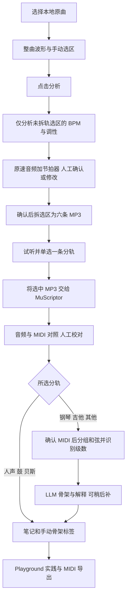
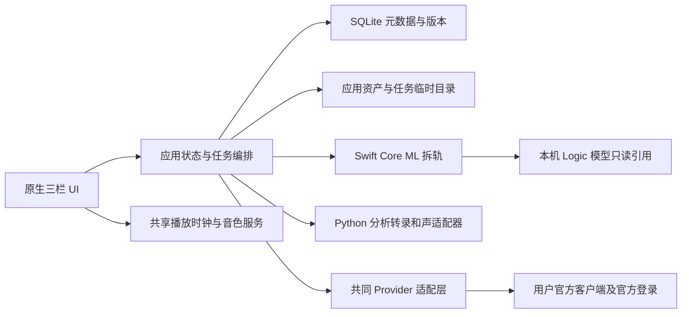

# Musicnote 初版开发文档

版本日期：2026 年 10 月 17 日。适用对象：产品设计与后续本地 macOS 实现。

Musicnote 是本地音乐学习与和弦知识库。用户从喜欢的 Jazz、Funk、R&B 歌曲中选取片段，听辨并校正 MIDI，理解和声、具体按法与编曲，再在 Playground 中组合素材，导出 MIDI 到 Logic 创作。学习笔记也容纳听感、配器和混音观察。

**当前处于设计阶段，不是已完成产品。** 本机已验证 Logic 模型独立拆轨及 MP3 导出；其余能力须按本蓝图实现和验证。文中的技术栈、参数及视觉 tokens 是推荐默认，已确认的交互和流程不得被这些默认改写。初版仅供本人在本机自用，不对外发布或分发。真正需要后续决定的问题集中在[待定事项](待定事项.md)，不需要逐项批准才能理解或采用本蓝图。

## 目录

1. [范围与实现基线](#范围与实现基线)
2. [歌曲组织与完整流程](#歌曲组织与完整流程)
3. [页面结构与交互状态](#页面结构与交互状态)
4. [选区与速度调性确认](#选区与速度调性确认)
5. [拆轨转录与 MIDI 校对](#拆轨转录与-midi-校对)
6. [和弦事件级数与骨架](#和弦事件级数与骨架)
7. [笔记与全局和弦卡](#笔记与全局和弦卡)
8. [全局聊天与订阅接入](#全局聊天与订阅接入)
9. [Playground](#playground)
10. [推荐技术架构](#推荐技术架构)
11. [数据模型与时间约定](#数据模型与时间约定)
12. [服务与事件契约](#服务与事件契约)
13. [任务恢复与文件清理](#任务恢复与文件清理)
14. [视觉与可达性规范](#视觉与可达性规范)
15. [性能与响应原则](#性能与响应原则)
16. [验收矩阵](#验收矩阵)
17. [开发阶段与实施风险](#开发阶段与实施风险)

## 范围与实现基线

### 初版必须包含

| 能力 | 初版边界 |
| --- | --- |
| 本地歌曲库 | 歌曲父页面、多个独立片段分析子项、歌名歌手封面、排序搜索与手动标签筛选 |
| 选区分析 | 整曲波形、可移动选区、原速循环试听、片段 BPM/调性检测与人工确认 |
| 拆轨与转录 | 确认后拆选区、六类 192 kbps MP3、单选一轨、MuScriptor（默认 `medium`）转 MIDI |
| MIDI 校对 | 音频波形与钢琴卷帘同步、独立试听开关、音符编辑、撤销重做、可选吸附 |
| 和声学习 | 仅钢琴、吉他、其他轨；按时间窗分组（兼容分解和弦与伴奏织体）、Musicpy 命名、基本级数、完整进行、LLM 骨架解释、用户手写骨架标签 |
| 笔记与和弦卡 | 片段实际 MIDI 按法和标准按法切换；全局文本和弦 hover 与发声 |
| 全局聊天 | 持久多会话、@歌曲/分析子项/整段会话、多对象比较、高亮收藏及回到来源 |
| Playground | 乐段、小节、和弦块；原曲素材与骨架等多种来源；移调、循环和标准 MIDI 导出 |
| 基础体验 | 默认三栏、左右独立收起、双收起填满主区、浅深主题、本地保存与故障恢复 |

明确不做：在线网易云搜索下载、旧播放器接口、自动全曲和弦扫描、多选乐器并行转录、自动把用户标签写入库、MIDI 转音频成品制作、云同步与团队协作、对外发布或打包分发。在线音乐接入后置。Logic 和弦模块及 djay 速度模型提取支线已放弃，不属于实现路径。

### 已验证和未验证

| 状态 | 事实及使用范围 |
| --- | --- |
| 已验证本机实验 | Logic Pro 12.3.1 build 6682 的 `ke77nsfms3_8024.mlmodelc` 可由独立 Swift/Core ML 程序加载，Metal Apple M5 推理成功，无需操作 Logic UI |
| 已核实映射 | 模型源序为贝斯、鼓、其他、人声、吉他、钢琴；最终文件按人声、鼓、贝斯、吉他、钢琴、其他命名 |
| 用户已试听认可 | `All of My Love - KOA.mp3` 的整曲拆轨结果；有效时长 275.887641723 秒。认可这一示例不等于所有歌曲质量保证 |
| 已实现压缩输出 | 六条 192 kbps MP3，各 6,623,025 字节，共 39,738,150 字节；完整解码帧数均为 12,166,645，44.1 kHz 立体声 |
| 示例增益 | 六轨统一衰减约 2.39 dB 防超峰。这是该歌曲计算结果，不是所有歌曲固定减益；吉他轨很弱，不能据此断言录音没有吉他 |
| 已有本机安装 | MuScriptor 0.2.2a1 位于 `/Users/yao/Desktop/musicnote/muscriptor`（venv Python 3.13）；`medium`、`large` 权重已在 HuggingFace 缓存。用户此前已手动将 MP3 转为 MIDI（`muscriptor/audio/`），说明 MP3 可直接输入；产品适配器和转录质量尚未验证 |
| 初版已实现（2026-10-17） | SwiftPM 原生 App（无 Xcode）。真实歌曲 20 秒选区已在 App 内跑通：选区 → Essentia 检测（0.9 s）→ 确认 → 拆轨与 MP3（15.7 s）→ MuScriptor medium 转录（23 s）→ 校对确认 → 和声（0.6 s）→ Codex 骨架 → @分析聊天。完成后只剩选中轨 MP3 与校正 MIDI，任务目录已清空 |
| 已实测接口 | libsndfile、AVAudioFile 与 ffmpeg 解码的 MP3 帧数和起点完全一致（偏移 0），无需另做编码器延迟校正。Codex app-server：关闭 shell、执行、插件和 MCP，再由 watchdog 中断任何工具条目；Claude Code：`-p --tools ""`，只放行 `--json-schema` 自带的 StructuredOutput。两者都通过结构化骨架校验。Codex 实际窗口 828,400，Claude 1M |
| 仍需人工使用验证 | 悬停卡片、拖拽编辑、播放手感等需要真人交互；分组参数尚未用标注短例回测（P0-05） |

现存实验入口：[run_separation.py](../work/run_separation.py)、[separate.swift](../work/separate.swift)、[export_mp3.py](../work/export_mp3.py)；说明见[使用说明](../work/使用说明.txt)，样例检查记录见[mp3-export.json](../output/mp3-export.json)。原曲位于 `/Users/yao/Desktop/musicnote/All of My Love - KOA.mp3`，现有六条 MP3 位于 `/Users/yao/Desktop/musicnote/output`。这些是实验资产，不能自动当成新产品库中的分析子项。

模型只引用用户机器上的 `/Applications/Logic Pro.app/Contents/Resources/MAMachineLearningResources.bundle/Contents/Resources/ke77nsfms3_8024.mlmodelc`。独立还原与块拼接尚未证明和 Logic UI 导出逐样本一致。旧大 WAV、实验预览和专属缓存已清理。初版仅自用，不打包或分发 Apple 模型；MuScriptor 权重为 CC BY-NC 4.0，Essentia 为 AGPL（版本锁定时核实），自用不受影响。若将来改为分发，须重新审查全部许可。

## 歌曲组织与完整流程

### 一首歌多个分析子项

歌曲是父级内容页，分析子项才拥有片段区间、速度、调性、选中分轨、校正 MIDI、和弦、骨架和笔记。一个子项只分析一个连续区间；另一段通过同一歌曲下“新增分析”重新选择用户已有原曲，不复用上次区间。允许重叠片段与不同调性，彼此独立。

歌曲列表类似 playlist：封面缩略图、歌名、歌手及可展开的分析子项。元数据优先读取文件内嵌信息，缺失时允许手填、用中性封面占位；封面可从文件或用户指定图片导入，不自动联网补齐。排序提供手动、歌名、最近编辑；搜索匹配歌名、歌手、子项标题、笔记和标签。推荐筛选同组多标签 OR、不同组 AND，并在界面显示当前条件。

不额外永久复制整首原曲，也不删除用户的源文件。保存来源文件名、基本指纹及区间偏移即可；源路径失效时显示“重新选择原曲”，已完成笔记、选中 MP3 和 MIDI 仍可用。

### 不可交换的处理顺序



三个确认关卡承担不同职责：

1. **点击分析**锁定当前区间，启动 Essentia。此时不能拆轨。
2. **确认速度与调性**保存 BPM、调性及节拍起点，才允许进入拆轨。
3. **确认 MIDI 校对**锁定本次 MIDI 版本，才允许和弦、级数及骨架分析。

只有钢琴、吉他、其他三类分轨进入和声流程。人声、鼓、贝斯仍可单选、转录和校对 MIDI，确认后直接进入 `ready`，可写笔记、打标签、被聊天引用，但不显示和弦、级数和骨架入口。选轨页在这三轨旁注明“不做和声分析”。

单选分轨后以“转为 MIDI”提交选择。在“完成校对”之前，六条 MP3 都保留为候选：转录失败或结果不理想时可以改选另一轨重新转录，无需重新拆轨（改选会放弃当前 MIDI 草稿，需用户确认）。“完成校对”后才清理未选的五轨。此后再换乐器，提示需重新提供原曲并新建子项，不能假装已删除的分轨仍可恢复。

### 分析子项状态

| 状态 | 可执行操作 | 进入下一状态的条件 |
| --- | --- | --- |
| `draft` | 选原曲、改区间、试听、填写标题 | 有有效区间并点击分析 |
| `detecting` | 看阶段进度、取消 | BPM/调性建议已返回，或展示失败项供手填 |
| `awaiting_confirmation` | 原速试听、调 BPM/调性、节拍器和拍点偏移 | 用户明确确认，两项都有有效值 |
| `separating` | 查看分块进度、取消 | 六条 MP3 编码并验证完成 |
| `awaiting_stem` | 六轨试听、单选 | 点击转 MIDI |
| `transcribing` | 进度、取消 | 有效 MIDI 导入完成；失败可重试或改选另一轨 |
| `editing_midi` | 校对、保存、撤销重做、播放；可改选另一候选轨重新转录 | 用户确认校正版本：和声轨进入 `harmonizing`，人声/鼓/贝斯轨直接进入 `ready` |
| `harmonizing` | 分组/命名进度，失败可保留 MIDI | 和弦事件和级数可查看并修订 |
| `ready` | 笔记、标签、聊天引用、送入 Playground、生成或重算 LLM 骨架 | 后续编辑按版本依赖标记分析失效 |

LLM 骨架不是子项状态，而是 `ready` 之后的独立 Job，自己显示未生成、生成中、完成、失败或旧版本。和弦与级数完成后，若 provider 已连接则自动尝试一次；provider 未连接、登录过期或额度不足都不会阻止子项进入 `ready`。自由笔记和手动标签在任何状态下都可编辑，不必等到 `ready`。

任务级 `failed`、`cancelled`、`interrupted` 记录在 Job 中，不把整个子项变成不可打开的错误页。状态同时展示当前保留了哪些可用成果以及恢复入口。

## 页面结构与交互状态

推荐采用统一三栏；不用同时实现三栏和浮窗两套聊天系统。

| 区域 | 内容 | 布局与行为 |
| --- | --- | --- |
| 左栏 | 歌曲/子项树、搜索、排序、标签筛选；Playground 入口 | 默认约 240 pt，可调 200–320 pt，独立收起；保留搜索与选中项状态 |
| 中栏 | 歌曲父页、分析流程、笔记、MIDI 编辑、Playground | 唯一主工作区；编辑页切换不重启任务；打开子项恢复滚动及播放位置 |
| 右栏 | 全局聊天及会话列表、模型/强度、@引用 | 默认约 360 pt，可调 300–480 pt；会话列表在栏内切换，不增加第四栏 |

左右折叠按钮固定在主工具栏，互不影响；两边都收起时主区占满内容区域。宽度不足时保留主区最小可用宽度（推荐 560 pt），暂时折叠右栏并提供显式恢复入口，不能悄悄丢失会话。聊天浮窗仅为待定可选形式，不作为初版交付条件。

主要页面：

- **歌曲父页**显示元数据、子项列表和“新增分析”。未创建子项时说明需重新选择本地音频；不显示不存在的整曲自动分析。
- **选区/确认页**顶部原曲来源与片段标题，中部波形，下方播放控制、起止/时长及当前阶段的确认操作。
- **MIDI 编辑页**上波形、下钢琴卷帘，共同时间轴；侧边只显示所选音符必要属性，避免堆叠混音台。
- **片段笔记页**顶部来源区间与调性/速度，随后完整和弦卡、骨架解释、手动标签和自由笔记。卡片顺序与时间一致。
- **Playground 页**顶部作品设置和乐段条，中部小节与和弦块，下方播放/循环和 MIDI 导出。
- **设置页**集中音色、主题、provider 连接和存储管理。模型窗口用量在聊天显示，不另设复杂上下文控制台。

空状态提供一个明确下一步。加载显示阶段文字及可获得的进度；未知时长不编造百分比。可重试错误保留当前视图和已填内容。登录过期、额度不足、模型不支持分别显示原因与对应动作，不统称“网络错误”。

## 选区与速度调性确认

### 波形选区

先从用户授权的源文件生成多级峰值缓存，显示整曲概览；拖左/右边界独立改变起止，拖选区中间保持长度整体平移，到文件边界时整体限制移动。支持水平缩放、滚动、起止/时长数值编辑、播放选区、循环选区、定位游标。拖动时不自动触发模型；空区间和越界区间不能分析。

显示时间精度推荐毫秒，实际裁剪以解码后的样本位置为准。通过播放器解码时间线定位，避免直接按 MP3 字节位置裁剪产生编码延迟偏差。点击分析后生成仅含 `[trimStart, trimEnd)` 的临时片段，保存 `sourceOffset` 与精确帧数；更改选区使旧的速度/调性建议失效，需要重新点击分析。

### Essentia 输入输出

BPM 与调性都只读取**选区内尚未拆轨的混合音频**，可在同一分析任务中并行计算。推荐节奏分析用 44.1 kHz 单声道分析副本，立体声原片段留给试听和拆轨；单声道转换及重采样不覆盖源文件。

节奏检测候选为 `RhythmExtractor2013`，记录 `bpm`、`ticks`、估计分布和有效置信度。该算法要求 44.1 kHz，`multifeature` 可提供拍点置信信息；`degara` 返回的 0 不能作为真实低置信评分。调性候选为 `KeyExtractor`，保存 `key/scale/strength`；初版围绕大调/小调与人工修正，不把它描述为完整调式、拍号和强拍检测器。[Essentia 节奏接口](https://essentia.upf.edu/reference/std_RhythmExtractor2013.html)、[调性接口](https://essentia.upf.edu/reference/std_KeyExtractor.html)

片段过短、节奏自由或信号不足时允许手填，不伪造高置信结果。检测 BPM 的范围应作为算法参数记录，不能用范围裁掉用户手填速度；半速/倍速歧义由用户试听确认，可提供“×2 / ÷2”辅助按钮。

### BPM 与节拍起点

自动建议按最近 0.5 BPM 四舍五入，正数采用 `floor(rawBpm × 2 + 0.5) / 2`，不是语言默认的银行家舍入。例如 93.24→93.0，93.25→93.5。保留原始检测值；界面及最终确认值只有 `.0` 或 `.5`。输入框允许键入数值和按 0.5 步进，提交前显示舍入后的值；非正数和非数值不可确认。

确认页的原片段始终按原速播放。节拍器与播放器共用音频时钟，提供开关、音量、循环；BPM 变更实时更新后续敲击调度，不中断或拉伸音频。系统先以检测拍点拟合节拍起点，再允许用户整体偏移；循环返回时节拍相位按循环位置重算，不能从零随意重启。

简短帮助文案：**一直早一点或晚一点，调整拍点偏移；越播越偏，调整 BPM。** 若实际片段存在明显速度变化，初版单一 BPM 只能提供近似网格，用户可选更稳定片段；可变速度地图不作为已具备能力。

### 调性与拍号

调性可改主音及大/小调，保存算法建议和用户确认值。每个子项独立，不继承整首歌曲的“唯一调性”。片段内再转调时显示当前单调性解释边界，允许重新切分子项；不默默引入自动转调算法。

拍号推荐暂用 4/4，并明确可修改；拍点不等于小节第一拍。推荐提供“把当前拍设为小节起点”，另存小节锚点，未确认时节拍器先不强调强拍。复合拍的脉冲单位及首拍方案见待定 P0-04。更改 BPM、拍号或起点只改变网格、级数分析上下文和导出映射，不改变已有音频/MIDI 的真实时间。

## 拆轨转录与 MIDI 校对

### 拆轨与 MP3

只有速度/调性已确认且确认版本匹配当前选区，才可调度 Logic 拆轨。输入是已裁好的片段，而非整曲先拆完再让用户选片段。六类输出固定为人声、鼓、贝斯、吉他、钢琴、其他。

复用 Swift Core ML 推理与还原算法，增加产品任务协议、选区帧数、取消、错误和临时目录管理。内部允许临时 PCM 以完成频域还原和编码，但发布给选轨页的六个资产必须已经是 **MP3 192 kbps**。试听及 MuScriptor 输入使用同一份选中 MP3，不能改用隐藏的无损分轨或拖延到转录后再压缩。

编码延用“六轨共享一个固定衰减量”的方式保留相对平衡，检查编码后峰值；不单轨自动增响，不附加音效。持久记录本次增益及编码器版本。示例 -2.39 dB 只作记录；全静音或极弱轨分别显示“静音/很弱”，弱轨仍可选择，不擅自删除。

验证六轨可解码、实际帧数对齐、有限数值和格式正确。MP3 编码器延迟/尾部填充按 gapless 信息还原；不得把容器显示的小幅时长差当作新增有效音频，也不得靠删掉音乐尾部“凑齐”。

### 单轨转录

单选页每轨都有试听按钮和单选控件，播放位置切换时保持同一时间以便比较。确认选轨后只向 MuScriptor 提交该 MP3 资产 ID 和路径，记录工具/模型版本、参数、输入校验和及处理时间。

MuScriptor 默认使用 `medium` 模型，设备用 `mps`。按分轨类型传入乐器约束 `instruments`，减少模型把一条分轨识别成多种乐器：

| 分轨 | 乐器约束 |
| --- | --- |
| 钢琴 | `acoustic_piano`、`electric_piano` |
| 吉他 | `acoustic_guitar`、`clean_electric_guitar`、`distorted_electric_guitar` |
| 贝斯 | `acoustic_bass`、`electric_bass` |
| 人声 | `voice` |
| 鼓 | `drums` |
| 其他 | 不约束；和声分析时排除 `drums` 和 `voice` 音符 |

适配器约定（依据本机 README 与源码）：

- 用 `.venv/bin/python -m muscriptor` 或 Python API 调用。该 venv 是在旧路径 `/Users/yao/Desktop/muscriptor` 建的，挪到现址后入口脚本 shebang 已失效；适配器不依赖 `.venv/bin/muscriptor`，或先用 `uv sync` 重建。
- 读取 `transcribe()` 事件流或 `--format jsonl`：音符起止是相对音频开头的秒，转换成片段整数微秒。不使用它导出的 MIDI 文件，因为库固定写 120 BPM，且 tempo 只在 track 0。
- `ProgressEvent` 按 5 秒块报告 `completed/total`，直接用作进度；取消在块边界检查，必要时终止子进程。
- **不输出力度**。所有转录音符写默认力度 100，并标记 `velocitySource = default`。
- MP3 经 soundfile/libsndfile 直接读取，不需要先解码成 PCM。仍须实测：MP3 编码器延迟是否已被去除，从而与拆轨 MP3 的播放时间对齐；5 秒块边界的连接质量；压缩音频对准确率的影响。

失败时保留候选 MP3 和必要诊断供重试；不自动换模型、换无损输入或重跑整曲。此处不承诺压缩对转录准确率没有影响。

### 钢琴卷帘

音频波形在上、MIDI 在下，共用秒/拍位置映射、游标、水平缩放和选区循环。音频与 MIDI 均有 Mute 和 Solo：无 Solo 时播放未 Mute 的来源；有 Solo 时只播放被 Solo 且未 Mute 的来源；两者均 Solo 可同步对照。按钮切换不停止播放，音频短淡入淡出避免点击噪声。

| 操作 | 行为 |
| --- | --- |
| 音符上下拖动 | 半音步进修改 pitch；经过新音高时即时试听，先关闭前一个预览音 |
| 音符左右拖动 | 修改起点并保持时长；吸附关闭时使用连续时间位置 |
| 拖音符边缘 | 改起点/终点，保证时长为正；不隐式拉伸其他音符 |
| 新增与删除 | 在空白处创建漏音，删除错音；提供键盘操作入口 |
| 撤销与重做 | 一次拖动算一个命令；包括增删、移动与长度。转录不提供力度，初版不做力度编辑 |
| 吸附 | 可选 1/4、1/8、1/16 等网格并可关闭；不自动量化 Funk/R&B 微节奏 |
| 点击音符 | 使用当前音色立即发声；点击/拖动结束发 note-off，停止与失焦清除预览音 |
| 正常播放 | 按实际起止调度多音（力度为默认值），和弦同时发声；循环边界和停止时处理悬挂音 |

试听音色只有钢琴、电钢琴、吉他三个清晰选项，所有页面共用音色服务。MuScriptor 只输出音高、起止和乐器，没有踏板事件，延音只能体现在音符时长里；音符分组不能把一个长音拆成新的 note-on。人工校对后的 MIDI 才是本应用“片段实际按法”的依据，并不宣称它完整还原录音演奏。

编辑可自动保存草稿，但“完成校对”才发布新的确认 MIDI 版本。后续音符变更立即标记相关和弦、级数和骨架为旧版本；重算只替换派生结果，不能覆盖人工笔记与手动标签。

## 和弦事件级数与骨架

### 连续 MIDI 到和弦事件

Musicpy 的 `detect` 面向一组音的和弦类型识别，文档覆盖原位、转位、不同排列、复合、变化与省略音；这不是对本应用转录输出的准确率测试。其进行分析函数另有实验性说明，不能当作已经可靠的自动整曲分组器。[Musicpy 命名文档](https://musicpy.readthedocs.io/zh-cn/latest/The%20algorithm%20to%20determine%20the%20chord%20type%20of%20any%20group%20of%20notes%20according%20to%20the%20logic%20of%20music%20theory/)、[进行分析说明](https://musicpy.readthedocs.io/zh-cn/latest/The%20algorithm%20to%20analyze%20the%20chord%20progressions%20of%20a%20piece%20of%20music/)

钢琴和吉他经常不是规规矩矩地弹柱式和弦，而是分解和弦、琶音、切分 comping，或者旋律和伴奏写在同一轨里。分组器按读和弦谱的方式工作，先以拍子和小节为准，再看音符：

1. **小节线**：用用户设定的小节起点；没有设定时，按“和弦起音大多落在小节线上或提前半拍”自动估计，并在界面提示，可一键采用。
2. **八分音符检测点**：从小节线起每个八分音符是一个检测点，主要依据在这一点按下的音，其次是还在响的延音。只有按下两个以上音、或低音区换了新低音的检测点，才能开始一个新和弦；旋律单音不会变成和弦。
3. **换和弦的代价按拍位递增**：小节线最低，其次半小节、其他正拍，反拍最高。没有明确证据时，和弦持续到下一个强拍（通常一整小节）；经过和弦只有在音确实变了时才占四分或八分。反拍按下并延音盖过下一拍的和弦（R&B/Funk 的提前半拍）按它所属的那一拍计算，事件仍保留真实起音时间。
4. **判断“有没有换和弦”只用基本和弦**（三和弦、sus、七和弦）；9、11、13、6/9 等色彩音在命名时再加，避免一个“胖”和弦把相邻的不同和弦合在一起。
5. **伴奏型合并**：同一和弦在持续期间反复按（节奏型、切分重复）只算一个和弦。
6. **低权重音不丢弃**：标为“和弦音 / 可能延伸音 / 可能经过音 / 可能旋律”，交给用户和 LLM 判断。

旋律和伴奏在同一轨时，用户可以在事件上手动排除某些音参与命名；排除只影响命名输入，不删除 MIDI 音符，也不改变卡片上的实际按法。重复段落不做强制对齐：第二遍和弦有变化时按实际音符分析。

MIDI 校对页在音频和钢琴卷帘之间显示和弦条，并在两层都画出小节线。校对中显示根据当前音符实时算出的预览；完成校对后可在和弦条上点选和弦对应的音符、拖动相邻和弦的分界（对齐八分音符）、右键改名、合并或拆分。

可选交叉校验：用 Essentia `ChordsDetectionBeats` 在同一分轨音频上按拍给出大小三和弦参考。只在根音明显不一致时提示核对，不覆盖 MIDI 结果。

权重系数、窗口长度和惩罚项都由标注短例回测（见待定 P0-05），不把一组固定参数宣布为所有风格的答案。分组依赖拍网格，所以改 BPM 或拍点偏移后分组要标为待核对（见失效传播）。

级数只基于所选分轨。钢琴或吉他轨里没有贝斯声部时，识别出的根音和斜杠低音可能与整体听感不同；和弦卡和级数旁标注“仅基于<分轨名>”，用户可以人工修改低音。

每个 `ChordEvent` 保存起止、参与 note IDs 及各音的角色和权重、织体提示（柱式/分解/混合）、用户排除的音、命名输入快照、原始候选、当前名称及人工覆盖。识别用音集可以归一化，但实际 voicing 必须保留八度、排列、重复音和起音差。音集不足时返回“未确定”并允许编辑名称，不造出缺失音。

用户可以移动事件边界、合并/拆分事件、修改名称和候选解释。改名称不自动改 MIDI；发生不一致时保留“人工命名”标记。相邻同名和弦仍是独立实例，休止也保留时间间隙。

### 基本级数约定

本地算法依据用户确认的片段主音、调式与和弦根音计算基本级数，保留和弦性质、变化音和斜杠低音；功能性解释由 LLM 补充。建议结构化字段为 `degreeIndex 1..7`、`accidental`、`quality`、`extensions`、`alterations`、`bassDegree`，显示罗马数字，手动骨架标签可用阿拉伯数字。

推荐统一以主音的大调音级为半音参照，并明确这一记法：C 小调的 E♭ 根音写作 ♭III，A♭ 写作 ♭VI；小调主和弦写作 i。避免在部分页面采用自然小调参照、部分页面采用大调参照却都写“三级”。保留用户/库给出的音名拼写，纯 MIDI 音高无法唯一确定升降号时按调性给候选并允许修订。

例如 C 大调 `Dm7 → G7 → Cmaj7` 对应 `ii7 → V7 → Imaj7`。斜杠低音不替代和弦根音；非调内和弦不强行改成调内音。副属、借用、三全音替代等是解释层候选，不能混淆为已确认基本级数。

### LLM 骨架是核心功能

同时保留完整进行与骨架。模型接收全部和弦名称、基本级数、实际秒数、拍位置与跨度、四分/八分等近似时值、确认调性、可用实际音符排列及各音角色标注、所选分轨和用户修订。由模型结合乐理判断主干、passing、连接、替代和其他可能解释，不写死“弱拍且短时值就是 passing”。

模型输出按事件 ID 引用的主干序列、被解释为连接/替代等的关系、理由、歧义和替代分析。原始进行和 MIDI 不被删减；无需强行归入常见模板。缺乏上下文时可以给多个骨架，而不是编造唯一正确答案。

用户自行填写或修改用于检索的骨架标签，例如 `4-5-3-6`、`4-3-2-1`。模型生成的是建议与解释，不自动成为最终标签。手动标签与模型骨架版本独立保存；换模型或重算不得清空标签。跨歌检索以用户保存的标签为准，并可点回完整进行核查差异。

## 笔记与全局和弦卡

片段页按时间先后展示完整和弦卡，重复和弦保留实例。卡片主体只呈现名称、键盘与原曲/标准切换等必要内容；不在每张卡上堆小节拍号。时值和拍位置仍保存在事件数据中，供分析与 Playground 使用。

默认“片段按法”读取已确认 MIDI 的 voicing 快照；切换“标准按法”只换预览，不改原 MIDI。分解或混合织体的事件：键盘高亮窗口内全部发声音，点击播放默认按原时序回放这一段，可切换为“合并成柱式和弦”（见待定 P1-06）。标准生成器至少保留符号要求的音集，例如 maj7 必须包含七音，变化音和明确省略音也要表达；不能把复杂和弦一律简化为三和弦。音区与排列默认见待定 P1-02。

应用共用一个和弦符号解析与预览组件，覆盖笔记和模型回答。泛指文本用标准排列；与特定 `ChordEvent` 关联的符号用该事件真实 MIDI 排列。解析失败保留原文，不把普通字母误当和弦；可手动标注为和弦。模型结构化引用优先于对回答文本的猜测解析。

hover 卡推荐宽 360–440 pt、高 150–190 pt，横向键盘通常显示约两至三组八度，必要时扩大范围以容纳低音和扩展音。显示和弦名，淡红色高亮实际发声音符；hover 只显示，不自动响；点击和弦/播放按钮按当前音色发声，键盘显示和声音始终读取同一个音符数组。键盘焦点和 Enter 提供等价操作，Esc 关闭。

自由笔记可记录和声、旋律听感、voicing、配器、编曲、混音及练习想法。自动分析结果与用户文本分区域存储，插入模型文字采取引用或复制动作，避免后台刷新替换用户正在编辑的正文。

## 全局聊天与订阅接入

### 会话与引用

聊天入口全局统一，拥有持久会话列表，**不按歌曲绑定会话，不另建跨歌曲聊天区**。切换中栏歌曲不会自动换会话；用户可以在同一会话比较多首歌、多个分析子项和先前对话。

输入 `@` 搜索歌曲、具体片段分析、已有整段会话。歌曲引用至少包含父级元数据与其子项清单，展开相关数据时列出实际包含的子项；具体分析引用包含该子项完整确认数据。对话引用的对象始终是**整个会话**，不是单条消息选择器。用户可同时选多个对象，发送前显示引用名称和范围。

每次发送将引用解析为版本快照：分析对象取最新已确认 MIDI/和弦/骨架，同时保留旧结果状态提示；历史回答继续关联当时的输入版本。用户后续修订音符后，再问问题应读取新数据，不能重写以前的回答来伪装一致。

回答文字支持高亮、收藏/书签；锚点保存消息 ID、字符区间和原文摘要，点击能返回原会话相应位置。消息不可因上下文压缩而从本地记录删除。收藏学习组合与整段会话引用是不同对象：收藏可以保存材料组合，但不会改变 @会话的粒度。

### 统一学习助手

每个新会话默认加载音乐学习助手/乐理老师角色：以 Jazz、Funk、R&B 的实际听感、和声与创作为重点，依据当前确认数据解释，区分事实、候选解释和练习建议；不知道时说明缺失的上下文，不虚构“已听过”音频。结构化音乐信息可以支持讨论，但没有实际音频访问时不能声称判断了混音音色。

角色配置、经审核的参考材料以及 @数据分别注入。教材 URL 只是来源定位，必须真实读取相关内容或事先整理成带来源章节的条目，才能用于本次回答。推荐用一个精简自用老师 skill 管理常用解释框架，不直接安装一大组社区技能；该 skill 目前尚未创建或安装。

候选材料：

- [Open Music Theory 和声分析](https://openmusictheory.github.io/harmonicAnalysis.html) 与 [Jazz 章节](https://viva.pressbooks.pub/openmusictheory/part/jazz/)：按实际可访问章节整理，不能声称已读完整教材。
- [music-composition-skills](https://github.com/jtydhr88/music-composition-skills)：仅作为待审核的写作/教学框架候选，关注和声、爵士和进行内容，过滤绝对化结论。
- [music-composition](https://github.com/SJY051/music-composition)：分析、教学与 voicing 资料可作候选，转位等乐理标注须校对，不当作权威答案。

参考条目保存标题、作者/来源、章节锚点、获取日期、内容版本与摘录范围；回答列出实际使用的来源。未能获取的链接只标“待读取”，不生成伪引用。固定角色和教材能帮助核查，不保证模型没有幻觉。

### Provider 能力与官方登录

骨架推理和聊天共用 provider 适配层。用户选择的是已订阅 Codex、Claude Code 的使用路径，不默认接入按量 API，不在失败时自动切到付费 API。

| Provider | 候选接入与已知边界 | 实施前验证 |
| --- | --- | --- |
| Codex | 候选为本地官方 `codex app-server` 的 stdio 接口。官方文档列有 `account/login/start` 托管 ChatGPT OAuth、`model/list` 的支持推理强度，以及 `thread/compact/start` | 文档允许既有本地/开源接入继续使用并推荐 Sign in with ChatGPT；商业/托管另有要求。新应用适用路径、当前客户端协议及账号能力仍需确认，不能泛化为订阅通用 API |
| Claude Code | 候选为用户自己安装、未修改的官方客户端及其登录流程；本应用不获取、存储或转发 Claude 凭据 | 官方区分运行未修改客户端与第三方借订阅凭据代发请求。具体客户端/SDK 接入及计费边界须验证；不能据此保证任意 Agent SDK 用法都消耗订阅额度 |

以上边界依据当前[Codex app-server 文档](https://developers.openai.com/codex/app-server)与[Claude Code 官方说明](https://code.claude.com/docs/en/legal-and-compliance)。产品化前复核，不由技术可调用推导所有发行形式均可使用。

UI 的“连接 Codex / 连接 Claude Code”打开对应官方登录流程，登录由官方客户端完成；不自建密码框，不抓取浏览器 Cookie 或本地 token。应用只保存 provider 类型、非敏感账号状态、会话映射及用户偏好。状态显示未连接、连接中、已连接、过期、额度耗尽、客户端不可用。

模型列表和推理强度根据账号与当前模型实际能力加载。Codex 使用可用模型目录；Claude 用已验证的客户端能力来源，无法自动列出时明确显示“能力未确认”，不硬编码假列表。只暴露支持的推理强度；切换模型重新校验，失效选项回到该模型支持的默认并提示。模型/上下文可用性与 Claude 自动压缩设置依实际版本变化，参考[模型配置](https://code.claude.com/docs/en/model-config)。

登录过期暂停当前请求并保留草稿，用户重新官方登录后可重试；额度耗尽显示可获得的恢复时间；模型不可用让用户选择可用模型，不静默代换；网络中断保留部分回答并标“未完成”。请求 ID 防止重试重复落库。切换 provider 时建立对应的新后端会话映射，以本地完整记录和明确的上下文快照继续，不要求两个官方客户端直接共享会话 ID；原有消息不被迁移过程覆盖。

### 上下文容量与压缩

用户期望最高 1M tokens，仅在实际模型、账号和客户端都支持时启用。**95% 是触发阈值：1,000,000 × 95% = 950,000 tokens，不是 95M，也不是压缩后的目标长度。** 实际窗口更小或客户端提前压缩时遵循更低边界。

推荐策略：`C = min(1,000,000, 实际可用窗口)`；`U` 包含历史、角色、参考和本次引用；`R` 为预留输出与后续协议开销；在下一次发送预计达到 `min(0.95 × C, C − R)` 前触发压缩。系统角色若已计入 U 不重复扣除。无法准确获取用量时显示估算，优先尊重官方客户端自动压缩，不通过猜测突破硬限制。

全局会话的完整消息永久存在本地数据库。压缩产物另存摘要、覆盖的消息范围、来源版本、未解决问题和引用索引。高亮、书签、手动笔记及音乐数据不被压缩删除。界面只显示紧凑用量及“已整理上下文”状态，用户无需操作复杂面板。

@整段会话先解析全部消息的稳定快照，再做去重与窗口预算。用 `(conversationId, revision)` 防重复展开，用访问集合阻止 A 引 B 再引 A 的递归。过长时对整段内容分批整理，并显示“整段会话已纳入上下文整理”，保存覆盖范围和来源链接；不能悄悄只截最近几条。若覆盖无法完成，明确标“引用未完整载入”，暂停依赖完整引用的回答或让用户重新选择范围，而不宣称完整读取。

### 分析权限与输入契约

音乐助手默认只能读取本应用显式提供的结构化快照和审核后的参考条目；不授予任意系统目录、终端执行、安装软件、删除文件或访问其他聊天的权限。数据读取采用白名单方法，如 `readAnalysisSnapshot`、`readConversationSnapshot`、`readReferenceSection`。provider 自带编码工具若不能实际限制到这一范围，则该适配器尚不满足接入验收，不能只靠提示词声称限制生效。

骨架请求建议最小结构如下，字段为产品契约而非某家 provider 的现成 API：

```json
{
  "schemaVersion": 1,
  "analysisId": "analysis-id",
  "inputRevision": {"midi": 7, "harmony": 3, "timing": 2},
  "key": {"tonic": "C", "mode": "major", "confirmed": true},
  "tempo": {"bpm": 94.5, "quarterNoteBased": true},
  "meter": {"numerator": 4, "denominator": 4, "confirmed": false},
  "events": [{
    "id": "chord-01", "symbol": "Dm7", "degree": "ii7",
    "startUs": 0, "endUs": 1269841,
    "startQuarterBeats": 0.0, "durationQuarterBeats": 2.0,
    "durationLabel": "约二分音符", "notes": [50, 57, 60, 65],
    "namingSource": "user-confirmed"
  }],
  "task": "解释完整进行与可能骨架，引用事件ID并保留歧义",
  "references": [{"id": "ref-id", "section": "section-id", "content": "实际读取的相关文本"}]
}
```

响应保存 `backboneEventIds`、带事件关联的连接/替代解释、可选不同解释、来源引用和自然语言讲解。返回事件 ID 必须存在、顺序合法、引用实际可追溯；不合法结构可重试一次或保留文字为未结构化回答，不能直接写坏和弦表。骨架标签需用户另行保存。聊天请求复用同一音乐快照格式，附会话与引用范围。

## Playground

### 作品与乐段

Playground 属于初版。新作品选目标调性、BPM、拍号，短练习一个乐段即可。建立 Intro、Verse、Chorus、A/B 段、Outro 或自定义名称，每段设小节数；推荐 4/8/16/32 快捷值并允许正整数自填。乐段可重排，内部块随段移动，不改素材库。

时间结构为作品→有序乐段→小节网格→和弦块。左右移动块改变位置，拖边改变长度，可一小节多个和弦，也可跨小节。同一单层和弦轨默认不允许无意叠块：拖入冲突区显示冲突，提供移动或明确替换，而非静默删除旧块。跨乐段尾部时提示延长乐段或缩短块；不自动挤掉后续内容。

### 素材来源

| 来源 | 导入保留内容 |
| --- | --- |
| 单个原曲和弦 | 名称、实际 MIDI voicing、来源链接、原时间跨度 |
| 完整原曲进行 | 所有事件，包括 passing、实际排列与时值；持续音按 note ID 去重，不在每张卡重复触发 |
| 简化骨架 | 骨架选择的事件及解释；必须保留来源完整进行入口，不能冒充完整原曲 |
| 学习收藏组合 | 用户明确收藏的有序和弦材料与各自来源；不是从文字书签自动生成可播放音乐 |
| 手动选择器 | 先根音，再大三、小三、大七、小七、属七、增、减、半减七等性质；变化/扩展可在支持范围内补充 |

手动选择时立即显示键盘并发声，确认后作为可拖拽材料进入作品。选择新项先停止上一预览，当前音色一致。库来源的每次拖入都创建素材实例与来源版本快照；编辑块不修改笔记、MIDI 原数据或同来源其他块。

### 移调与按法

导入时读取来源片段的确认调性和结构化级数，对照作品目标调。推荐同调式先按主音半音差移调，保留和弦性质、变化/省略音、斜杠低音、相对音程和排列；名称按目标调拼写重新生成。原曲模式移动实际 MIDI 音符，不另造配器；标准模式生成满足该和弦音集的标准排列。键盘、名称、声音由同一实例派生。

跨大小调默认仍保留半音音程关系与和弦性质，标明“移调，不自动调式重配”；原级数作为来源信息保留，目标级数重新计算。不把大七自动改成小七。若未来需要按目标调式逐级重配，须明确独立操作及具体规则，见待定 P0-06。

移调导致超出 MIDI 0–127 时禁止静默夹到边界，提示整体移八度或取消。允许整体八度调整作为显式实例编辑；不能分别折叠每个音破坏实际 voicing。

### 时值播放与导出

素材导入把真实时间转换为来源 BPM 下的四分音符拍位置，并保留未量化偏移。默认让素材按目标作品 BPM 播放；此时改变速度属于创作行为，与分析编辑页“修改 BPM 不改变原时间”不同。提供来源时长提示，避免把两种时间语义混用。

推荐和弦块内部保存音符的相对起止。拖块边缘默认按比例调整块内部音符时间，预览变化并支持撤销；同音多次演奏不被合并。完整进行导入建立多个块，但共享延音通过唯一素材音符引用避免重复 note-on。骨架导入推荐沿用原主干起点，前一主干块延长至下一主干起点；第一主干前留原空隙，末块到原片段末尾，用户可再调整。这是明确标记的简化节奏，不伪称原演奏。

播放使用钢琴、电钢琴、吉他，支持连贯播放和循环；推荐范围为选区、当前乐段、全曲，控件明确当前范围。停止、跳转、循环边界发送必要 note-off，防止长音悬挂。

导出标准 MIDI，建议 Type 1、PPQ 960，写入作品 BPM、拍号和实际音符音高/位置/时长/力度（转录来源为默认值）；乐段可写 marker，调性信息在 MIDI 能表达的范围内写入。导入 Logic 后无需手动重建节奏。MIDI 保存演奏事件，不含所选试听音色的音频；音色对应由 Logic 中乐器决定。导出前报告越界音符、零时长和块冲突，不自动修成另一首作品。

## 推荐技术架构

### 一套主方案

推荐 **SwiftUI macOS 原生壳 + AppKit 自绘时间编辑区 + AVAudioEngine 音频层 + 本地工作进程 + SQLite**。理由是目标仅 Mac，现有 Core ML 实现为 Swift，原生播放与键盘交互便于统一时钟；高密度波形/钢琴卷帘可单独优化，不把全部音符变成大量普通表单控件。具体前端栈尚待 P0-01 确定，本方案用于估算模块职责，不表示已立项。

音频推理复用 Swift helper，Essentia/Musicpy/MuScriptor 各用 Python 适配器，每个适配器一个独立 venv（MuScriptor 沿用本机现有 venv，Essentia 的 arm64 wheel 可能不支持 Python 3.13，需单独选版本）；不修改系统 Python。多个模块不必做成网络微服务，初版以应用编排器和可停止的子进程即可。数据库由应用单写入者管理，worker 只产出结果文件和事件；SQLite 适合本地单应用数据和低写入并发，不需要另起数据库服务。[SQLite 使用场景](https://www.sqlite.org/whentouse.html)

初版仅自用、仅 Apple Silicon，以本机为运行环境，可以直接依赖本机已有的 Logic、`/opt/homebrew/bin/ffmpeg` 和 MuScriptor 安装，但路径要集中在设置里，不散落在代码中。



### 模块输入输出与职责

| 模块 | 输入 | 输出 | 不承担的职责 |
| --- | --- | --- | --- |
| Source/Selection | 用户源文件、选区 | 元数据、波形缓存、片段临时输入、来源偏移 | 永久保存整曲 |
| TempoKey | 未拆轨片段 | 检测值、拍点、调性强度 | 自动拆轨或认定第一强拍 |
| Separation | 已确认区间及版本 | 六条对齐 MP3 和编码记录 | 决定转录哪一轨 |
| Transcription | 单条选中 MP3 | 原始 MIDI 草稿及对齐元数据 | 自动确认或隐藏校正 |
| MIDI Editor | 音频、MIDI 草稿 | 校正音符、确认 revision | 用网格强制重写演奏 |
| Harmony | 确认 MIDI、调性、人工修订 | 和弦事件、voicing、基本级数 | 用固定时值规则认定 passing |
| Skeleton | 完整和声快照 | 模型解释、骨架候选、来源 | 覆盖 MIDI 或写入最终标签 |
| Notes/Cards | 事件、用户正文 | 笔记、可播放和弦引用 | 将标准预览写回原曲 |
| Chat | 会话、@对象、参考 | 持久消息、结构化来源、高亮书签 | 任意文件系统或 shell 操作 |
| Playground | 材料快照、作品设置 | 实例编辑、连贯播放、MIDI 导出 | 修改知识库原始素材 |
| Storage/Jobs | 版本、任务清单 | 事务、恢复、限额与清理 | 删除用户外部源文件 |

初版不建插件市场、复杂工作流引擎或多租户服务。算法参数和 provider 能力有版本记录即可，不额外引入通用规则平台。

## 数据模型与时间约定

### 本地实体

ID 建议 UUID。创建/修改时间用 UTC 保存、本地显示。各实体由外键关联，关键结果带 `schemaVersion`、`inputRevision` 与工具版本，避免只有文件名没有来源。

| 实体 | 关键字段 | 关系与约束 |
| --- | --- | --- |
| `Song` | title、artist、album、coverAssetId、sortIndex | 父级页面，1:N AnalysisItem；歌曲标签不替代片段标签 |
| `AnalysisItem` | songId、title、state、sourceRefId、trimStartUs、trimEndUs、sourceSampleRate、sampleBounds、confirmedTempo、confirmedKey、beatOriginUs、meter、barAnchor、timingRevision、selectedAssetId、selectedStemKind | 一个连续选区、最多一条选中分轨；确认数据绑定选区版本；selectedStemKind 决定是否进入和声流程 |
| `SourceRef` | 原文件名、授权 bookmark/路径提示、大小、时长、指纹 | 外部文件引用，不是源曲副本；重新选择时核对是否同一来源 |
| `Detection` | analysisId、rawBpm、roundedSuggestion、ticks、confidence、rawKey、strength、参数、版本 | 建议与人工确认值分开；低置信可为空 |
| `Asset` | ownerId、kind、相对路径、hash、bytes、codec、rate、channels、decodedFrames、gain、lifecycle | 标记候选/选中/临时/待清理；只对应用拥有路径执行删除 |
| `MidiRevision` | analysisId、revision、status、parentRevision、transcriberVersion、confirmedAt、MIDI assetId | 草稿与确认版明确区分；最新确认版供分析 |
| `MidiNote` | midiRevisionId、noteId、pitch、velocity、velocitySource、startUs、endUs、channel、instrument | noteId 支撑编辑与事件引用；实际时间优先；转录音符 velocitySource 为 default。命名为 MidiNote 以免与笔记 NoteDocument 混淆 |
| `ChordEvent` | analysisId、harmonyRevision、order、startUs、endUs、noteIds、noteRoles、texture、excludedNoteIds、candidates、symbol、manualOverride、degree、namingSource | 重复和弦有不同 ID；未识别保留空名称；excludedNoteIds 只影响命名 |
| `Voicing` | chordEventId/素材ID、sourceRevision、orderedPitches、noteTiming、velocity、kind | 实际快照与标准生成参数分开，不能互相覆盖 |
| `Skeleton` | analysisId、inputRevision、provider/model、backboneEventIds、relations、explanation、alternatives、status | 模型派生版本；不拥有音符 |
| `NoteDocument` | analysisId、正文块、revision | 用户笔记独立保存，分析重算不修改 |
| `ManualTag` 与关联表 | text、normalizedText、type、ownerId | 歌曲/片段/骨架标签由用户写入；原样显示、规范值检索 |
| `Conversation` | title、providerBinding、modelPreference、createdAt、revision | 全局实体，没有强制 songId |
| `Message` | conversationId、sequence、role、content、status、providerTurnId、usage、inputSnapshotId | 本地完整保存，含未完成状态 |
| `Mention` | messageId、objectType、objectId、objectRevision、scope、resolvedSnapshotId | 会话 scope 固定 wholeConversation；禁止无限递归 |
| `Highlight` 与 `Bookmark` | messageId/笔记ID、range、quotedText、anchor、label | 高亮书签返回源位置，消息压缩不影响锚点 |
| `ContextSnapshot` | 覆盖对象/消息范围、内容版本、summary、contentHash、tokenEstimate | 去重与压缩产物，不能替代本地原文 |
| `ReferenceMaterial` | sourceURL、title、section、content、retrievedAt、version | 只有有实际内容的条目可注入模型 |
| `LearningCollection` | title、orderedMaterialRefs | 可播放学习组合，和一般文本书签区别保存 |
| `PlaygroundProject` | title、targetKey、bpm、meter、revision | 1:N Section，独立于原歌曲 |
| `Section` | projectId、name、order、barCount | 小节数改变需处理已有块，不静默截断 |
| `ChordBlock` | sectionId、startQ、durationQ、symbol、notesSnapshot、voicingMode、sourceRef、sourceRevision、transform | 素材实例；跨小节允许，跨段需显式处理 |
| `Job` | type、ownerId、inputRevision、status、stage、progress、attempt、tempManifest、error、heartbeat | 恢复与取消依据；重试复用相同输入快照 |

关系骨干：`Song → AnalysisItem → MidiRevision → MidiNote`；`AnalysisItem → ChordEvent → Voicing`；`AnalysisItem → Skeleton/NoteDocument/ManualTag`。聊天通过 Mention 引用这些实体而不拥有它们；Playground 保存独立快照及回链，删除或修改原笔记不意外改变已有作品声音。

推荐对歌名/歌手/笔记/会话使用 SQLite FTS 索引，对标签规范值建普通索引；子项时间和和弦顺序建联合索引。媒体文件放文件系统，数据库保存相对路径及校验信息；不把全部 PCM 放数据库。

### 单位与坐标

| 坐标 | 约定 |
| --- | --- |
| 原曲时间 | 解码后的源时间 `sourceTimeUs`，整数微秒；源采样率与实际裁剪帧另存 |
| 片段时间 | 从所选片段有效起点计 0，区间采用左闭右开；`sourceTimeUs = trimStartUs + localTimeUs` |
| MIDI 实际时间 | MidiNote 起止存片段整数微秒；MP3 delay/padding 与转录器时间偏移必须先统一到此坐标 |
| 四分音符拍位置 Q | 四分音符为 1；`Q = (t − beatOrigin) × BPM / 60`，t/beatOrigin 用秒；Q 可因弱起为负 |
| 小节 | 另存小节锚点，不把第一个检测拍点自动当强拍；n/d 拍每小节含 `n × 4 / d` 个 Q |
| MIDI 导出 | PPQ 960 推荐值；`tick = round(Q × 960)`，保持顺序及正时长，记录舍入误差 |
| 音高与力度 | MIDI pitch 0–127，velocity 1–127；转录音符统一为 100；发声 note-off 与编辑删除分开处理 |

对分析子项改变 BPM/偏移后，保留 MidiNote 的微秒时间，重算网格与派生时值，不改声音速度。Playground 以 Q 为作品编辑坐标，改作品 BPM 会改变播放秒数，这一创作语义必须明确。

复合拍 BPM 的脉冲解释暂未定，初版推荐内部始终用四分音符 BPM，另存 clickUnitQ；若界面展示附点四分拍速，需要明确换算，不能让同一数字在分析和导出中含义不同。

和弦时值同时存实际持续时间与 Q 跨度。仅在足够接近时给“约八分音符”等显示标签，不因生成标签量化实际音符。标准 MIDI 的 tempo 为整数微秒/四分音符，导出换算误差应在验证中度量。

### 修改后的失效传播

| 修改 | 标记需重算 | 保持不动 |
| --- | --- | --- |
| 原选区 | 检测、确认、拆轨及全部下游；推荐已完成子项另建版本/子项 | 用户笔记和旧确认成果仍可查看 |
| 确认 BPM/偏移/拍号 | 派生拍位置、时值、和弦分组（待核对）、骨架上下文 | 音频、MidiNote 微秒起止、音高 |
| 确认调性 | 基本级数、音名拼写候选、骨架 | 转录 MIDI、实际 voicing、手动笔记 |
| 音符修改 | 和弦分组/命名、级数、骨架 | 用户标签及笔记，历史回答 |
| 人工和弦名称/边界 | 相关事件级数与骨架 | MIDI 原音符；人工覆盖保留并提示核对 |
| 仅预览标准按法/音色 | 无 | 全部分析及实际 MIDI |
| Playground 实例 | 当前作品 | 来源知识库及其他实例 |

分组以拍网格为候选边界，因此更改 BPM/偏移需将分组标记待核对；这不需要重新转录。

后台结果回写须比较 inputRevision；用户已修改时将结果标为旧版，不覆盖新草稿。重分组可能导致旧人工覆盖不能准确对应新事件，此时进入“待核对覆盖”列表，不能丢弃人工文本或盲贴到另一个和弦。

## 服务与事件契约

以下为建议内部接口，不要求部署 HTTP 服务。应用与 worker 可用带 requestId 的 JSONL 经 stdio 通信；日志发 stderr，stdout 仅发协议消息，避免解析自然语言日志。

| 操作 | 必要输入 | 结果或事件 |
| --- | --- | --- |
| `source.inspect` / `waveform.read` | 授权源引用、时间范围、缩放级别 | 元数据、分层峰值、总时长 |
| `analysis.detect` | analysisId、trimRevision、片段资产 | tempo/key 建议，阶段完成 |
| `analysis.confirm` | expectedRevision、confirmedTempo/key、beatOrigin、meter | 新确认版本；满足拆轨前置条件 |
| `stem.separate` | 确认版本、片段资产、outputPolicy=mp3_192 | 六条候选 Asset 与时长/增益记录 |
| `stem.select` / `midi.transcribe` | 单一候选 assetId、analysisId、确认版本 | selectedAssetId、MIDI 草稿 |
| `midi.applyEdit` / `midi.confirm` | 基础 revision、编辑命令/确认 | 新草稿/确认版、失效通知 |
| `harmony.analyze` / `harmony.override` | 确认 MIDI、调性、分组参数/人工编辑 | 和弦事件与基本级数 |
| `skeleton.generate` | 完整和声快照、provider 配置 | 流式文字、结构化结果或错误 |
| `chat.send` / `chat.cancel` | conversationId、正文、Mention 对象 | 消息增量、用量、引用覆盖、完成状态 |
| `provider.capabilities` / `provider.login` | providerId | 官方登录状态、可用模型/强度/容量 |
| `playground.insert` / `playground.exportMidi` | 素材快照、目标设置/作品版本 | 实例或 MIDI 文件 |
| `job.cancel` / `job.retry` | jobId、attempt、当前 inputRevision | 取消确认、重试状态、保留文件清单 |

通用事件例：

```json
{
  "event": "job.progress",
  "jobId": "job-id",
  "analysisId": "analysis-id",
  "attempt": 1,
  "inputRevision": 3,
  "stage": "separate",
  "completedUnits": 4,
  "totalUnits": 8
}
```

`asset.ready` 只在文件写完、关闭并验证后发布。`job.failed` 带结构化错误码、可读原因、`retryable` 和保留资产，不包含账号密钥。`job.cancelled` 必须在 worker 已停止或确认不再发布结果后发送。`analysis.stale` 指明失效范围，不清空旧页面。

建议错误码覆盖：`SOURCE_MISSING`、`INVALID_RANGE`、`TEMPO_KEY_UNCONFIRMED`、`MODEL_UNAVAILABLE`、`GPU_UNAVAILABLE`、`ENCODE_FAILED`、`TRANSCRIPTION_FAILED`、`REVISION_CONFLICT`、`LOGIN_REQUIRED`、`QUOTA_EXHAUSTED`、`CONTEXT_TOO_LARGE`、`DISK_FULL`。应用只按码决定按钮，完整诊断可按需展开。

## 任务恢复与文件清理

### 存储布局

推荐数据根在用户 Application Support 下，具体应用 ID 随打包确定；下面是逻辑布局，不是本次要创建的目录：

```text
Musicnote/
  library.sqlite
  assets/<asset-id>/selected.mp3
  assets/<asset-id>/corrected.mid
  covers/<asset-id>.<ext>
  jobs/<job-id>/manifest.json + 临时输入和阶段结果
  cache/waveforms/
  references/经审核的实际章节内容
```

已完成分析的长期音频只有用户选中的乐器片段 MP3；另存校正后 MIDI、笔记、分析/来源元数据。原始转录音符可作为小型数据库 revision 留作撤销依据，不保留重复大音频。波形属于可重建缓存，可按容量清理；原整曲波形无需长期保存。

### 队列与阶段发布

推荐单个重型本地音频任务串行执行，避免拆轨与转录抢 GPU/内存；同一选区 BPM 和调性可并行。UI、试听、轻量数据库查询与网络聊天不必等队列结束。每个任务固定输入 revision，任务清单记录其拥有的文件。

阶段产物先写任务目录，完成解码/格式/长度检查后原子发布到资产目录，再以数据库事务关联。失败时旧成果仍可用。文件和数据库不具备共同事务，需以 manifest 记录“待发布/已发布/已关联”，启动恢复时补齐关联或清理未引用资产，不能凭文件名推断成功。

取消先发协作信号；Core ML 单次推理若不能中断，在块边界检查取消。必要时终止本任务 helper，禁止其再发布迟到结果，之后再清理占用文件。不要为了取消一个任务杀死用户的 Logic 或官方聊天客户端中其他会话。

### 生命周期清单

| 时点 | 保留 | 清理或恢复策略 |
| --- | --- | --- |
| 刚选原曲 | SourceRef、可重建波形缓存 | 不复制永久源曲 |
| 等待速度/调性确认 | 选区临时混合音频、检测值、确认草稿 | 退出页面可恢复；明确取消该任务才清理临时音频 |
| 等待选轨 | 六条已编码 MP3 候选、短期混合片段 | 选轨提交前不能提前删除候选 |
| 选中并开始转录 | 六条候选 MP3（标记选中轨）、任务清单 | 混合 PCM 在不再供确认页使用后清理；未选轨保留到完成校对 |
| 转录失败 | 六条候选 MP3、错误信息 | 可重试或改选另一轨，无需重新拆轨 |
| 转录成功、校对中 | 六条候选 MP3、MIDI 草稿、分析元数据 | 删除模型临时输出与重复版本文件；可改选另一轨重转（放弃当前草稿需确认） |
| 完成校对 | 选中 MP3、校正 MIDI、分析元数据 | 删除未选的五条候选 MP3 |
| 完成分析 | 选中 MP3、校正 MIDI、分析、笔记、元数据 | 不保留原整曲或整首乐器轨；不保存未选择的其他片段 |
| 用户明确取消当前处理 | 已提交成果、草稿笔记；若已选轨则保留其 MP3 供主动重试 | 清理任务专属临时文件；新建但未提交选轨的候选随任务清理；界面说明重试是否需要原曲 |
| 崩溃/重启 | Job、manifest 和已发布成果 | `running` 改 `interrupted`；先提供继续/重试/丢弃，不自动清除失败输入 |
| 删除分析子项 | 其他子项和独立 Playground 快照 | 确认后移除所属资产/数据；检查引用计数；不删除外部 SourceRef 文件 |

后台清理只处理 manifest 所属路径及无引用缓存，不扫描并删除桌面“相似文件”。失败/待恢复任务可在存储页显示大小和“丢弃任务”操作，默认不按隐蔽超时删除重试数据。普通成功任务日志只保留简短诊断摘要，不保存模型大转储。

文件可用空间不足时在开始重任务前提示估算临时空间；中途不足则停止发布并保留最小恢复输入。备份建议用数据库一致性快照加资产清单与文件，而不是在写入时只复制一个 SQLite 主文件。是否提供整库备份和歌曲包导出由 P1-05 确认，媒体所有权及清理语义不依赖这项选择。

## 视觉与可达性规范

以下是一套可实施的推荐 tokens，具体色值与字体细节可在首轮视觉样稿中微调。默认浅色淡米白，深色低饱和炭灰；以文字、内容分组和留白建立层级，不依赖装饰渐变。

### 色彩

| Token | 浅色 | 深色 | 使用 |
| --- | --- | --- | --- |
| `background` | `#F7F4EE` | `#181A1B` | 整体画布 |
| `surface` | `#FFFCF7` | `#232629` | 卡片、面板、输入 |
| `surfaceRaised` | `#FFFFFF` | `#2D3135` | hover 卡、弹出菜单 |
| `textPrimary` | `#282723` | `#E7E5DF` | 正文、标题 |
| `textSecondary` | `#69665F` | `#ADB0AC` | 辅助文字，仍需可读 |
| `borderSubtle` | `#DDD7CD` | `#454A4F` | 非唯一状态提示的分隔线 |
| `controlBorder` | `#837C72` | `#828A91` | 输入边框与关键控件轮廓 |
| `accent` | `#8F414B` | `#E3A3AA` | 主操作、播放指针、焦点 |
| `onAccent` | `#FFFFFF` | `#251B1D` | 主按钮文字 |
| `accentHover` | `#7D3540` | `#EDB7BD` | 主按钮 hover |
| `accentPressed` | `#6D2D37` | `#CF8F99` | 主按钮 pressed |
| `selectionFill` | `#F1DDE0` | `#493139` | 音频/文字选区底色 |
| `keyActive` | `#F0CBD0` | `#C78693` | 和弦键盘淡红高亮 |
| `noteFill` | `#49665B` | `#AAC8BB` | MIDI 音符 |
| `onNote` | `#FFFFFF` | `#17241E` | 音符上的文字 |
| `success` | `#37634E` | `#A3C7AD` | 成功文字与图标 |
| `warning` | `#7A571D` | `#DFC18B` | 待校正、资源不足 |
| `error` | `#9A3842` | `#F0A5AC` | 失败及危险操作文字 |

普通正文与背景目标对比度至少 4.5:1，大字号至少 3:1；关键边界、焦点与控件状态目标至少 3:1。实际混色、透明度和键盘黑白键上都要验收，不能只检查 token 原色。淡红高亮另加轮廓/圆点或音名标签，避免仅靠色相识别按键。禁用状态可降低强调程度，但说明文字仍可读。

### 字体与尺寸

| 用途 | 推荐 |
| --- | --- |
| 中文/西文 | 原生系统字体优先；中文回退 PingFang SC、Hiragino Sans GB、sans-serif；西文回退 SF Pro、Helvetica Neue、sans-serif |
| 页面标题 | 24 pt / 行高 32，semibold |
| 区块标题 | 17 pt / 行高 24，semibold |
| 正文及聊天 | 14 pt / 行高 22，regular |
| 控件与列表 | 13 pt / 行高 18；歌曲标题 medium |
| 辅助说明 | 12 pt / 行高 18，避免低于 11 pt |
| 时间、BPM、计数 | 系统等宽数字；代码回退 SF Mono、Menlo、monospace |

和弦符号的 ♭、♯、△、ø 等需检查字体回退，不以字体缺字替换成错误和弦。文本放大后布局保持可用，数字的位数变化不能使播放控制左右跳动。

### 按钮与输入状态

主要按钮高度 36 pt、左右内边距 14 pt、圆角 8 pt；紧凑按钮 28 pt，但点击区域推荐至少 32×32 pt。每个流程区只突出一个主按钮，名称直接说明下一步，如“确认并拆轨”“完成校对”。次级按钮用 surface 和可读边框；文字按钮用于低频辅助动作；删除只在相关操作中显示危险色。

所有按钮提供默认、hover、pressed、disabled、focus、loading：hover 只轻微改变背景/边框；pressed 用更深/更亮的同色；disabled 禁止触发并说明必要前置条件；键盘 focus 用 2 pt 焦点环、2 pt 外间距；loading 保留按钮宽度和文字，防重复提交，可取消任务另给按钮。输入框错误以边框、图标和具体文字共同提示，不只变红。

推荐间距基数 4 pt，常用 4/8/12/16/24/32；面板内边距 16–24；卡片圆角 10；输入圆角 6；分隔线 1 pt。阴影只用于浮层：浅色黑色约 8% 不透明度、0/4/16 pt，深色约 24%；常规页面靠边界和间距，不层层加阴影。

### 编辑区细节

波形基础颜色使用 textSecondary 的适当透明度，已选区用 selectionFill；边缘拖柄至少 10 pt 视觉宽、20 pt 命中宽，颜色与轮廓并用。中间平移、边缘缩放使用不同鼠标指针。实际播放指针始终清晰位于选区之上，缩放时保持当前定位点。

钢琴卷帘按白/黑键音行做轻微交替背景，强弱网格线区别适度；音符用 noteFill，选中音符加 accent 外框，正在发声音符另加小标识。转录没有力度信息，音符不按力度改变亮度。原始与已编辑内容用小标记区分，不靠多套鲜艳颜色。

右聊天栏的引用 chip 使用简短对象名称，可展开来源与版本。模型输出、用户文字和系统状态在排版上区分，不以复杂气泡装饰占用横向空间。高亮收藏使用可读底色，深色主题不直接沿用浅色半透明黄。

### 键盘与动效

Tab 可到达折叠按钮、选区输入、播放、音色和确认操作；Space 控制当前主播放器，文本编辑中不抢占空格；Esc 停止预览/关闭浮层。Command-Z / Shift-Command-Z 撤销重做，方向键可移动选中音符并有修饰键细调；快捷键在菜单中可见。

和弦 hover 卡同时支持焦点进入，屏幕阅读器读出和弦名、音符列表与当前按法。收起栏保留可访问的展开按钮；展开恢复焦点与滚动位置。推荐折叠动画 160 ms，hover 100 ms；遵循减少动态效果设置。播放指针的准确时间由音频时钟驱动，不由动画时长推算。

## 性能与响应原则

以下是开发验收目标，尚非测得性能承诺：普通交互反馈约 100 ms 内；拖选区、拖音符和滚动争取 60 fps；点击音符的可感知延迟目标低于约 50 ms，实际受音频设备和缓冲影响。初轮以用户机器测量后调整，不硬套全部 Mac。

- 波形分级计算、只绘制可见区；大文件流式解码，避免 UI 线程读取整曲 PCM。临时裁剪在后台进行。
- 播放、节拍器、MIDI 预览共用音频采样时钟；UI 游标只是其视图。密集音符播放不得在主线程逐个定时触发。
- 重任务队列限制并发；单块预测后释放中间张量，编码完就释放临时音频；不永久缓存全尺寸频域输出。
- 搜索做短延迟合并和分页；聊天流式文本批量刷新，不让长对话不断重排全部消息。
- 同一数据 revision 的引用快照去重；相同请求可复用已验证阶段结果，不因切换页面重复推理。
- 模型加载、检测、拆轨、编码、转录分阶段计时。基准按片段长度、音符数和机器记录；已有整曲实验速度不能当产品 SLA。

推荐验收素材覆盖 10 秒、60 秒和 180 秒片段、较长原曲波形以及密集 MIDI；具体容量上限根据实测决定。超大选区显示时间/空间估算并允许用户取消，不自动缩成更短片段。

## 验收矩阵

所有“通过”需要后续实现后实际验证。算法质量用听辨与人工标注短例判断，不以生成频谱图作为默认流程。

| 编号 | 场景 | 必须满足的结果 |
| --- | --- | --- |
| A01 | 同一首歌新增第二个分析子项 | 重新选择原曲，可选不同区间；原子项数据、调性和标签不变 |
| A02 | 波形选区拖边/拖中间/缩放 | 边界独立、整体平移保长度、范围不越界；可数值输入和原速循环 |
| A03 | 先点击分析但未确认 BPM/调性 | 只运行选区 Essentia；任何拆轨 worker 都未启动 |
| A04 | BPM 93.24、93.25 及手填 | 分别建议 93.0、93.5；保留 raw 值，确认显示只有 .0/.5 |
| A05 | 播放中改 BPM/偏移 | 节拍器实时变化、音频不断；固定错位与累积漂移可分别调整 |
| A06 | 片段转调、错误/弱检测结果 | 子项调性独立且可手填；不得用整曲调性强行覆盖；无置信不伪造 |
| A07 | 未确认拍号/首拍 | 不把 ticks 当强拍；能按推荐默认编辑拍号和小节锚点 |
| A08 | 拆轨结束与单选转录 | 六条 MP3 已是 192 kbps；只能单选；MuScriptor `medium` 直接接收该 MP3，并带对应分轨的乐器约束；完成校对前可改选另一轨 |
| A09 | 高峰值/极弱轨/MP3 延迟 | 统一衰减、可解码且有限；弱轨提示不删；有效帧与来源偏移准确 |
| A10 | 失败/取消/崩溃 | 可恢复已完成阶段；转录失败的选中 MP3不丢；不删用户原曲 |
| A11 | 编辑与同步试听 | 双区共同游标；Solo/Mute 不中断；改音高、起点、长度、增删可撤销重做 |
| A12 | 连续拖音高、循环、停止 | 旧预览音及时关闭，无悬挂音；多音同时发声，时值正确 |
| A13 | Funk/R&B 非网格节奏 | 关闭吸附后保留真实时间；不经用户操作自动量化 |
| A14 | 和弦分组与复杂命名 | 标注集含柱式、扫弦、琶音、分解和弦/Alberti、切分 comping、旋律加伴奏同轨、提前换和弦、跨界延音，以及 maj7、m7、C7♯9、转位、省略、复合；分解织体能恢复完整音集，不按每个 note-on 切新和弦；记录候选/失败，不伪造百分百正确 |
| A15 | 级数与人工修订 | 调性改变只重算派生级数；斜杠低音不当根音；名称/区间可改并保留来源 |
| A16 | LLM 骨架 | 输入含完整进行与时值/音符；输出引用有效事件；不以固定弱拍规则代替推理；不改 MIDI；provider 不可用时子项仍进入 ready |
| A17 | 重算与手动标签 | 用户标签/笔记不被覆盖；相关分析变旧；历史回答关联旧快照 |
| A18 | 卡片重复和弦与 voicing 切换 | 重复实例不合并；实际/标准切换音画一致、不改 MIDI；maj7 标准按法保留七音 |
| A19 | 全局聊天与 @ | 换歌曲不换会话；可多对象比较；@会话为整段，递归去重且范围透明 |
| A20 | 高亮、收藏、历史回跳 | 重启后仍在；返回原消息/文字；压缩不删原记录 |
| A21 | 官方登录与模型能力 | 不采集凭据；模型/强度按实际能力；登录过期、无额度、不可用模型有明确恢复 |
| A22 | 上下文到达阈值 | 支持1M时按950000触发或更早安全边界；较小窗口提前；过长引用不静默截最近消息 |
| A23 | Playground 多种素材 | 单和弦、完整进行、骨架、收藏、手动选择均可进入；passing 和原曲 voicing不被无意省略 |
| A24 | 乐段/小节/块与循环 | 可自命名/重排乐段、设小节数、多和弦每小节/跨小节、改块长度、循环与连贯播放 |
| A25 | 移调与来源隔离 | 同调式保持性质/变化/低音/相对排列；跨调式不暗中重配；源笔记和其他实例不变 |
| A26 | 导出到 Logic | MIDI BPM/拍号/音高/时值正确；tempo舍入与tick误差可度量；无零时长、悬挂音和意外重触发 |
| A27 | 三栏双主题 | 左右独立折叠，双折叠填满主区；字体/控件对比度、焦点、键盘替代交互合格 |
| A28 | 保存与清理 | 完成子项只留选中片段 MP3、校正MIDI和数据；不留整曲副本/未选轨；损坏重启不误认成功 |
| A29 | 助手权限 | 不能从模型工具调用读取任意系统文件、执行shell或改原音频；只取本应用授权快照 |
| A30 | 来源与参考真实性 | LLM引用可回到实际章节/数据版本；仅有URL的材料不能标为已读 |
| A31 | 选人声/鼓/贝斯轨 | 可转录、校对并进入 ready，可写笔记和标签；不出现和弦、级数、骨架入口 |
| A32 | 分解织体的和弦卡 | 键盘高亮窗口内全部音；默认按原时序回放，可切换柱式；手动排除音只影响命名 |

质量指标分开记录：转录音高/起止人工修正量、分组边界错误、命名可接受候选、骨架解释人工认可。不能用一个“AI准确率”掩盖不同阶段错误。小型标注集先覆盖用户真实关心的风格，随后再扩大。

## 开发阶段与实施风险

### 按依赖推进

分阶段是实施顺序，不缩减初版范围；完成最后阶段才可称初版闭环。

| 阶段 | 交付与依赖 | 出口条件 |
| --- | --- | --- |
| 0 技术接入核验 | 确定平台基线；验证 MuScriptor 适配器调用与 MP3 时间对齐、Essentia、Musicpy 和两种订阅候选路径 | 明确可调用版本、输入输出及阻断项；不靠替换用户选择规避失败 |
| 1 本地库与时间基础 | Song/AnalysisItem、SourceRef、SQLite、资产目录、三栏骨架、播放器/选区/波形 | 可建多子项、恢复页面、原曲不永久复制；时间与播放器测试通过 |
| 2 片段分析闭环 | BPM/调性确认、节拍器、选区拆轨、MP3单选、转录队列 | 三道顺序约束成立；失败重试/清理有证据；选区时长对齐 |
| 3 MIDI 与和声 | 卷帘校对、音色、撤销、分组/命名、级数、卡片/笔记 | 人工修正和版本失效可用；复杂和弦短例回测通过可接受标准 |
| 4 骨架与全局聊天 | 共用provider、核心骨架解释、手动标签、@、多会话、书签/上下文管理、教材角色 | 账号边界和工具权限验证；音乐数据新旧版本清晰；完整引用可追溯 |
| 5 Playground | 乐段/小节/块、多来源、移调/按法、循环、MIDI 导出 | 作品能在Logic继续创作；素材原数据不被编辑污染 |
| 6 初版整体验收 | 双主题、可达性、性能、断点恢复、存储清理、完整A01–A32回归 | 用户用一个真实片段走完学习→笔记→创作路径；无隐含缺失初版模块 |

阶段 0 中 provider 验证应尽早做，因为骨架和聊天是核心；不能全部完成后才发现订阅接入不成立。音色/播放底层在阶段 1 就建立，可由后续 MIDI 卡片与 Playground 复用。

### 关键风险与处理

| 风险 | 影响与处理 |
| --- | --- |
| Logic 版本或资源变化 | 模型路径/schema可能变化；启动检查版本、输入输出和六轨映射，不支持时给明确提示，不能猜通道命名；只引用本机资源 |
| 依赖许可 | 初版自用不发布：Logic 模型只在本机引用，MuScriptor 权重 CC BY-NC 4.0 和 Essentia AGPL 对自用无碍。若将来分发须全部重审 |
| 分解织体与单轨根音 | 时间窗分组的参数需回测；单一分轨缺少贝斯时根音可能偏差。用候选、角色标注、手动排除和改低音弥补，并在界面标注“仅基于所选分轨” |
| 订阅provider边界 | 官方客户端、协议、登录和额度可变化；能力探测与真实接入验收先行，无法支持时列阻断，不暗换按量API |
| MP3转录与分组歧义 | 用户已定192kbps流程；通过用户校对、短例回测和可编辑候选弥补，不假装算法唯一正确 |
| 原曲外部引用 | 文件移动/权限失效时需要重选；完成子项仍依赖自己的选中MP3，避免丢源就无法阅读 |
| 时间与延迟误差 | 统一解码坐标、记录裁剪与转录偏移、共同播放时钟；测试MP3 gapless及MIDI导出 |
| LLM结果过期或幻觉 | revision检查、来源引用、结构验证和用户标签；不修改音符、不伪称听到未读取音频 |
| 临时音频占空间 | 所属manifest、阶段清理、错误保留最小输入、启动恢复和可见存储页；不无界积累日志 |

待定事项的编号、推荐值和最晚决策点见[待定事项清单](待定事项.md)。本蓝图不要求此刻开始开发，也不把参考技能、依赖或模型安装视为已授权实施。

## 模型自主分析（最小闭环，已实现）

完整方案见 `docs/模型自主分析集成方案.md`，这里只记录实现与运行要点。

- 入口：「笔记与和弦」页顶部的“模型自主分析”，可选 Codex 或 Claude Code，模型和推理强度沿用设置里的选择。
- Claude Code 走 MCP：`claude -p --tools "" --strict-mcp-config --mcp-config <本次运行的配置> --allowedTools <9 个 mcp__musicnote__*> --setting-sources "" --disable-slash-commands`。MCP 服务器是 `workers/mcp_bridge.py`（只用标准库），它只负责协议转发：通过本次运行专用的 Unix socket（0600 权限、随机 token）把调用转给 App 里的 AutoToolbox，工具和 Codex 那条路是同一套，选区锁定、预算和复核记录都在 App 里执行。工具一次只执行一个。watchdog 检查启动时的工具列表和每次 tool_use，只要出现 Musicnote 以外的工具就中止；MCP 没连上也会报错。`MCP_TOOL_TIMEOUT` 设为 15 分钟，留给转录这类耗时工具。
- 工具（`AutoToolbox`）：inspect_analysis、run_logic_chords、run_transcription（MT3 / MuScriptor，只保留原声钢琴和电钢琴）、align_transcriptions、bar_evidence、local_audio_check、harmony_draft、note_review、submit_analysis。所有工具都锁定到“分析 ID + 选区版本”，选区外的小节和时间一律拒绝。
- 默认步骤写在 `AutoAgent.manual` 里，模型可以跳过、调换或回头重做；疑难位置先用 note_review 记录要分辨的问题，复核后再记录证据、决定和停止原因。
- 预算：28 次计费工具调用，900 秒。证据（Logic 候选、两路转录）按选区版本缓存复用。
- 结果：submit_analysis 只把结果存进本次 AutoRun 的 `proposal`（带角色、理由、待确认点、调性建议和证据来源），不改当前和声。用户点“采用这个结果”时由 `AutoAdoption.adopt` 复制成新的当前和声版本，并按现在的调重算级数，然后重新生成骨架；完整进行、和弦卡、播放和聊天都跟着它走。之后“重新分析和声”会生成新的程序版本，但模型结果还在，可以随时再采用。当前和声是采用来的模型结果时，不会再提示“算法已更新”，重新分组前也会先确认。用户的 MIDI、笔记、标签和旧和声版本都不改动。
- Codex 安全：Codex 的动态工具只能在 code mode 下调用，所以只有分析专用的 Codex 进程开启 `code_mode_host`。这个 JS 宿主拿不到 fs、require、process 和 fetch；其他 Codex 功能仍然关闭，watchdog 只放行动态工具调用和只读的 MCP 资源列表。
- MT3 GPU 环境：`workers/mt3/.venv` 是叠加在 `/Users/yao/Desktop/midi/.venv` 之上的薄环境，通过 `.pth` 的 `site.addsitedir` 引入原环境，只额外安装了 `jax-mps` 0.10.x（`--no-deps`）。worker 在导入前关闭 Shardy，并把 T5X 的默认 mesh 改成 1×1；用户自己的 MT3 目录只被引用，不会被修改。41.5 秒音频约 17 秒转完。
- Logic：`workers/logic_chords_worker.py` 先校验框架的 SHA-256，再把 `workers/logic/harmony_bridge.m` 编译到 `cache/logic/<sha>/`。网格为空时直接报错，不会当成“没有和弦”。
- 命令行验收：`swift run MusicnoteChecks autoanalyze <dataRoot> <analysisId> [model] [effort] [--claude]`；`MusicnoteChecks adopt <dataRoot> <analysisId>` 采用最近一次结果。

## 选区的小节吸附与流程调整

- 流程现在是：选区 → 速度调性 → 拆轨选轨 → 转录 → 和声与笔记。不再停在 MIDI 校对这一步：转录完成就直接确认，并开始和声分析；结果页的 MIDI 标签里仍可修改。旧数据如果停在 `editingMidi`，会显示“继续分析和声 / 先打开 MIDI”。
- 整曲小节线：选区阶段先对整首原曲运行 `essentia_worker.py bars`（RhythmExtractor2013 拍点，加上强拍相位判断），结果存在 `AnalysisItem.songGrid`。Essentia 没有强拍检测，所以给每种拍号和相位打分：拍同步的和声变化（chroma novelty）加低音起音能量，在小节第一拍上最强的那个相位胜出；同时给半速读法（一小节 8 个检测拍）打分。
- 同一首歌的其他片段已经确认过速度和小节线时，会按它自动校准：速度约为检测值一半就切到半速，并把强拍对齐到已确认的小节线。
- 界面：可选吸附小节 / 吸附拍 / 不吸附（按住 ⌥ 临时不吸附），可切换半速和拍号，可把小节线整体挪一拍，可一键把选区对齐到小节线，可开节拍器听重拍。起点、终点离小节线多远会直接显示；相位把握不大时会提示用耳朵核对。
- 速度确认页会沿用整曲小节线：拍号，和第 1 小节在选区内第一条小节线上（选区吸附过就是 0）。BPM 优先用片段自己的检测值，前提是它和整曲读法相差不到 4%。

## 小节线核对与选区前预读

- 起因（U&I）：整曲拍点在这段锁到了附点八分，拍点间隔约 0.36 秒，而 125.5 BPM 的四分是 0.478 秒，于是吸附和速度确认都用了错的小节线，整体偏了 2 拍。和弦的时间是对的，只是读进了错的格子，看起来全从第 3 拍开始，小节开头都是 ↳。
- `BarLineCheck`：统计 Logic 换和弦点（权重 1）、低音换音（0.4）、和弦起音（0.1）落在小节里的位置，提前半拍进入的给下一拍算半份。哪个候选第 1 拍的得分明显高于现在的（≥ 1.6 倍且 ≥ 22%），就建议整体挪几拍；大多落在反拍上就建议挪半拍（连拍点一起挪）。故意不用分组后的和声，因为它就是按现在的小节线分出来的，拿来核对会自己证明自己对。它还会给出和弦走向的重复周期，前后两遍可以互相对照。
- 用在三处：自主分析的 `check_bar_lines` 工具（模型在 submit 的 `barLine` 里给 shiftBeats 和理由，用户一键采纳）、笔记页的自动提示卡片，以及 `shiftBarLine`（只改 timing 的小节线，音符时间不变；采用来的模型结果只需换网格重读，程序分组则会重新分析）。
- 选区前预读：用原曲取证时（Logic、MT3/MuScriptor 原曲转录），会往前多读一小节，再切回选区，这样选区起点之前就按下、延续进来的和弦也能被看到。分轨只覆盖选区，所以分轨没有预读。
- 整曲小节线只有在选区内拍点稳定时（拍点间隔和整曲速度相差不到 8%）才会被速度确认页沿用；不稳定时，选区页和确认页都会提示。

## 提前进入的和弦与小节线微调

- 很多舞曲、流行歌的钢琴会把和弦提前一个八分按下（push），比如 U&I 每个和弦都在前一小节第 4 拍后半进入，Logic 的换和弦点却在第 1 拍。小节线本身没错，所以不改网格。显示时按 `BarEvidence.readingStart` 的规则读：在某一拍前 0.1–0.55 拍之内按下、并且延续过这一拍至少 0.9 拍的和弦，画在这一拍上，带 ↶ 标记；存储的时间不变。图例里可以关掉。短的反拍经过和弦不受影响。
- 和弦卡片的位置文字、发给聊天和骨架的数据都会标出“提前八分进入第 N 小节”。
- 小节线微调：完整进行旁和自主分析图例里有 «‹ › »，可以按一拍或一个八分整体挪动（`shiftBarLine`，音符时间不变；挪半拍时拍点会一起挪）。
- 修了 `BarEvidence.position` 的 bug：第 4 拍后半会被错算成“下一小节第 0.5 拍”。

## 拆轨的前导余量

- 起因（U&I）：选区吸附在小节线上，但钢琴把第 1 小节的和弦提前一个八分按下，起音在选区开始之前。拆轨和转录只拿到选区，于是开头一段没有 MIDI。
- 现在拆轨时会往前多带一小节余量（按确认的速度，最多 4 秒，不会超出文件开头），和选区一起拆。拆完后每条分轨切成两段：分轨文件仍然正好是选区，播放、波形、试听都不受影响；余量部分单独存成 `<分轨>-leadin.flac`（`StemAsset.leadInPath`，时长记在 `SeparationRecord.leadInUs`）。
- 转录（MuScriptor，以及自主分析里的 MT3/MuScriptor/Logic 分轨来源）会把前导和分轨接成一段来转，再按 `Pipeline.trimLeadIn` 切回选区：延续进选区的音从 0 开始保留，只在余量里响过的音丢弃。删除未选中的分轨时，它的前导也会一起删掉。
- 旧的拆轨结果没有前导，需要重新拆轨才能用上。

## 转录不再只保留钢琴

- 起因（ttK）：和弦在“其他”轨的合成器铺底上，但自主分析的 MT3 只保留 GM 0–5 号乐器（钢琴），28 个 synth_pad 音全被丢掉，结果是 0 个音；MuScriptor 也固定按钢琴乐器来转。
- 现在所选分轨（钢琴、吉他、其他）已经分离过，转录保留其中全部有音高的乐器：MT3 用 `--programs all`（只去掉鼓，乐器按 GM 族命名），MuScriptor 按所选分轨类型转（`--stem <分轨>`，“其他”就是全部乐器）。原曲来源只去掉鼓和人声。
- 工具里的来源名从 `piano` 改成 `stem`（已选分轨），旧证据里的 `piano` 仍按 `stem` 识别。用户 MIDI 那条转录本来就用所选分轨，没有变化。

## 从歌曲开头截的片段

- 起因（Puppet）：选区从 0 秒开始，前面没有音频可做前导；MuScriptor 漏掉了 0.03 秒处的第一个和弦（MT3 抓到了）。在前面垫 1 秒静音再转，就能在 0 秒处转出来。
- 现在没有前导时（从歌曲开头截，或者是旧版拆轨），转录前会先垫 1 秒静音（`Pipeline.silencePadUs`），转完用 `trimLeadIn` 切回选区。自主分析的原曲转录在没有预读时也这样处理。MIDI 的转录信息里记录了 `startContext`（lead-in / silence / none）。
- 旧的从开头截的片段，笔记页会提示“重新转录”。

## 和声的两种状态：核对中 / 已确定

和声只有一份，只在“完整进行”这一个地方改。它总是处在两种状态之一（`HarmonyDraft`：每个片段最多一份草稿）。

**核对中（有草稿）**：对照音频确认和弦、动手改，最后确定或放弃。
- 进入方式：模型分析跑完，结果直接成为草稿；或者在已确定状态点“修改”，复制当前版本作为草稿。
- 页面上只放核对需要的东西：
  - 状态条：“核对中 · 模型分析的结果 / 修改已确定的和声”，右边是【放弃】【确定】。
  - 模型给的核对信息：总结、调性检查、小节线建议、待确认（附听原曲/听分轨）；证据来源和复核记录折叠在“依据”里。如果草稿不是模型来的，就显示小节线自动核对。
  - 可编辑的小节格子（见下）。
- 不显示骨架解释和和弦卡片。
- 改动都只写进草稿：改名或添加的和弦一律按标准按法改写这段音，改过的音存在 `draftNotes`；撤销在草稿里一步步退回。
- 【确定】调用 `DraftCommit.commit`：改过的音变成新的已确认 MIDI 版本，草稿变成新的和声版本（按现在的调重算级数，清掉待确认点），删除草稿，重新生成骨架（优先用跑这次分析的模型）。【放弃】直接删除草稿。
- 已有草稿时再点“开始分析”，会先提示新结果会替换当前草稿。

**已确定（没有草稿）**：看懂、练习、拿去用。
- 完整进行：一行和弦走向，加只读的小节格子。点和弦发声；点小节号从这一小节起播放原曲和和弦。
- 【播放原曲和和弦】：原曲和每个和弦（优先用片段里的实际按法，否则用标准按法）同步播放，正在响的和弦高亮。【修改】进入核对中。
- 下面是和弦与按法卡片（只能看和听：片段/标准、播放、收藏、送入 Playground，没有编辑菜单），然后是骨架解释。

**模型自主分析**这一块平时只有一行：选模型、开始/停止、运行进度。结果不在这里显示。旧的分析结果如果还没核对过，会提示“开始核对”。

**编辑格子**（`ChordBarsView.swift`，规则在 `HarmonyEdit`）：
- 悬停高亮；按下立刻发声（双击自己判断，0.35 秒内点两下就是改名）。
- 拖和弦中间是移动：半透明影子按八分音符吸附显示落点，原位置留空。拖左右边缘改长度，可以跨小节。
- 被盖到的时间让给拖动的和弦：完全被盖住的消失，落在中间的那个分成两段，不到一个八分音符的碎片删掉；拖边缘缩短时，贴着的邻居跟着填上。
- 空白处的淡 ＋ 添加和弦；固定四列，最后一格是“加一小节”；末尾空小节可以用 × 删掉，也会自动去掉。
- 弹窗指向所在小节的下边框；和弦名不区分大小写（`ChordSymbol.normalizeInput`）。

## 多选分轨合并转录

- 选轨时，钢琴、吉他、其他（和声分轨）可以多选；人声、鼓、贝斯仍然只能单选，也不做和声分析。可以单独试听某一轨，也可以“试听所选合并”。
- 转为 MIDI 时，如果选了不止一轨，`Pipeline.prepareStemMix` 会先把所选分轨叠加成一轨（`amix normalize=0` 按分离时的电平直接相加，再加一个限幅器防止过载），写成 `mix-钢琴+其他.flac`，前导余量也同样合并。结果记在 `SeparationRecord.mix / mixKinds`，`AnalysisItem.selectedStem` 是第一轨，`extraStems` 是其余几轨。
- 凡是用到“所选分轨”的地方都走 `AnalysisItem.transcriptionStem`：MuScriptor 转录、试听分轨、MIDI 标签页、自主分析的 stem 来源。多轨合并时 MuScriptor 按 other（全部乐器）来转。清理未选分轨时，选中的每一轨和合并后的那一轨都保留。
- 实测（ttK）：只选钢琴转出 86 个音，钢琴 + 其他转出 139 个音。

## 第 1 小节 = 选区开头

- 起因（Endlessly）：选区开头正好在拍点上（用户截取时就在小节开始），但整曲强拍检测的相位偏了 3 拍，速度确认页沿用了它，把第 1 小节放在 1.242 秒；程序分组和模型分析都在这个错的网格里做，后面全偏。
- 规则：选区开头落在整曲拍点上（吸附到小节或拍，±60 ms）时，第 1 小节第 1 拍就是选区开头（`barAnchorUs = 0`，拍点起点也是 0）。整曲小节线只用来帮你吸附，不会改写你选的第 1 小节。只有自由拖动、不在拍点上的选区，才退回原来的逻辑（拍点稳定时沿用整曲小节线，否则自动估计）。速度确认页会提示“第 1 小节第 1 拍就从选区开头算起”；模型看到的也是“选区开头就是第 1 小节第 1 拍，这是确定的”。
- 已修正的数据：Endlessly、ウェザーリポート、I’m OK（新片段）这三个片段的第 1 小节改回选区开头（`MusicnoteChecks fixstart`；程序分组的重新分组，采用的模型结果按新网格重读）。修改前的数据库备份在 `backups/library-before-fixstart-2026-10-18.sqlite`。

## 灵感进行与灵感集合

- 目的：边看分析边听，把喜欢的和弦（可以来自不同的歌）拖到一起，拼成 4 / 8 / 16 小节的进行，循环播放，存进“灵感集合”。
- 入口：主内容区右下角的灯泡按钮，打开独立的浮动窗口“灵感进行”（`InspirationWindow`，NSPanel，置顶、可以拖到主窗口外，记住位置和大小）。切换页面时窗口不受影响。
- 能拖进来的：已确定的完整进行里的和弦、小节号（整小节，保持各和弦的位置和长度），和弦与按法卡片，自由笔记和骨架解释里的和弦名（`RichText.swift` 里的 `ChordTextView` 按住移动 4 pt 开始拖）。核对中的格子不能拖出去，因为在那里拖动是编辑。
- 声音规则：拖进来的就是点击时听到的那几个音。拖动和点击用同一个取音函数：格子里是 `heard()`（片段里的实际按法，否则标准按法），卡片是当前显示的片段或标准按法，文本里和点击时一样。拖动内容是 `ChordDragPayload`（文本 `musicnote-chords:` 加 JSON）；拖动开始时同时记在 `AppModel.activeChordDrag`，窗口才能在悬停时按拖动内容的长度显示影子。
- 窗口里：和完整进行核对时同一套操作（`InspirationEdit`，单位是四分音符拍）。拖入时影子按八分音符吸附，整小节吸附到小节线；被覆盖的时间让给新和弦，完全被盖住的消失，落在中间的那个分成两段；可以拖动、改长度、＋ 输入（标准按法）、双击改名、右键删除、撤销。改小节数时，放不下的部分会被裁掉。第一次拖入时，BPM 取来源片段的速度。
- 保存：窗口编辑的是“当前灵感进行”（`InspirationProgression`，`inCollection=false` 时是草稿），每次改动都自动保存。点“保存到灵感集合”后它进入集合，之后的修改直接存进这一条。“新建”时，如果当前草稿还没保存，会先问你。
- 灵感集合（侧边栏）：每条显示小节、来源，可以播放 / 循环（正在响的和弦高亮），可以调 BPM，可以选调号变调。右键菜单可以在窗口里编辑或删除。窗口里按原调编辑和播放，变调只用在集合的播放和显示上。
- 智能移调（`InspirationTranspose`）：用和弦自动识别原调；走最近的方向（不超过 6 个半音）；每个和弦整体挪八度，让最低音落在 C2–C3 附近、最高音不超过 C6，和弦内部排列不变；和弦名按目标调拼写。关掉智能移调就是普通上移。

- 聊天里的 # 引用：在全局聊天输入 `#`（输入开头或空格后面；和弦名里的 # 不会触发），或者点输入框下面的 # 按钮，会列出灵感集合里的进行，可以按名字或说明搜索。选中后会作为“#灵感进行”引用发出去（`MentionKind.inspiration`）。发给模型的内容（`InspirationSnapshot`）是这条进行实际播放时的样子：按播放调号拼写的和弦名、级数、每个和弦听到的音、第几小节第几拍、拍数、BPM、原调和播放调，以及每个和弦的来源。

- 小节线必须落在拍点上（`BeatGrid.beatAlignedAnchor`）。起因（Go Play）：速度确认页把第 1 小节预填为选区开头（0 秒），用户随后把拍点偏移调了 +180 ms，第 1 小节却没有跟着动，于是没有一个拍点被判为强拍，传给 Logic 的强拍列表是空的，报“拍点为空”。现在确认速度、保存速度网格、模型工具读网格时，第 1 小节都会吸附到最近的拍点；第 1 小节在选区开头时，吸到开头处或之后的第一个拍点。已修正的数据：Go Play（0 → 0.180 s）、YES IT IS（0 → 0.020 s），用的是 `MusicnoteChecks fixanchor`，修改前的数据库备份在 `backups/library-before-fixanchor-2026-10-18.sqlite`。

## 确认第 1 小节（转录之后）

- 流程：选区 → 速度调性 → 拆轨选轨 → 转录 → **确认第 1 小节** → 和声与笔记（只有和声分轨才有这一步；状态复用 `editingMidi`，显示“确认第 1 小节”）。
- 界面（`BarOneView`）：显示片段开头至少 8 秒、约 3 小节的 MIDI 卷帘。同时按下（60 ms 内）的音算一个起音（`BarOne.onsets`），点一个起音就表示第 1 小节从这里开始：按已确认的速度画出小节线和拍线，这个音之前的部分是弱起（灰色），同时播放这个起音。【播放核对】从这里前一拍开始播放分轨，带节拍器，重拍加重。【就从这里开始】把第 1 小节和拍点起点都定在这个音上（速度不变），然后分析和声；【保持现在的】不改。默认选中离当前第 1 小节最近的起音。
- 之后在笔记页底部点“重新选择第 1 小节…”，会用同一个界面改。程序分组会重新分组，采用的模型结果按新网格重读。
